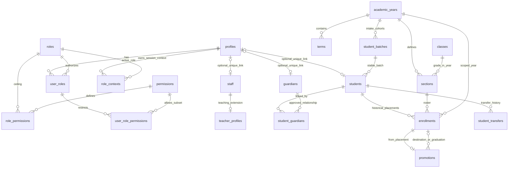
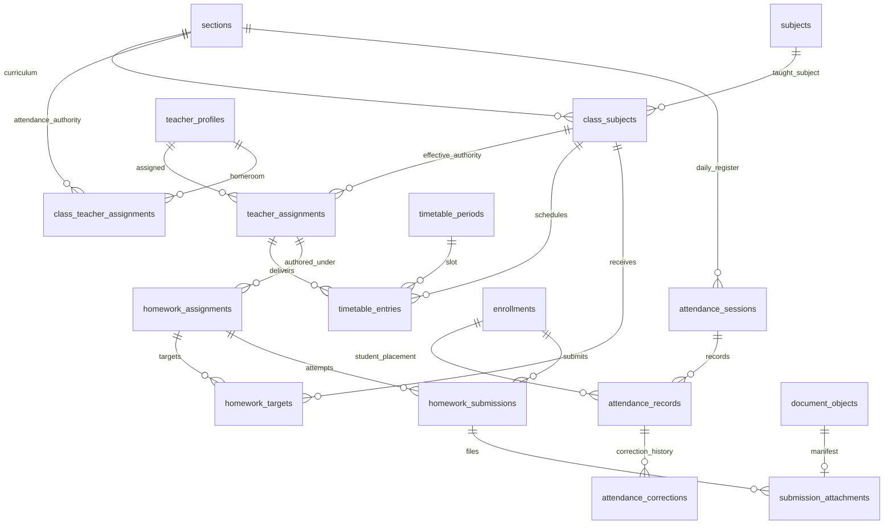
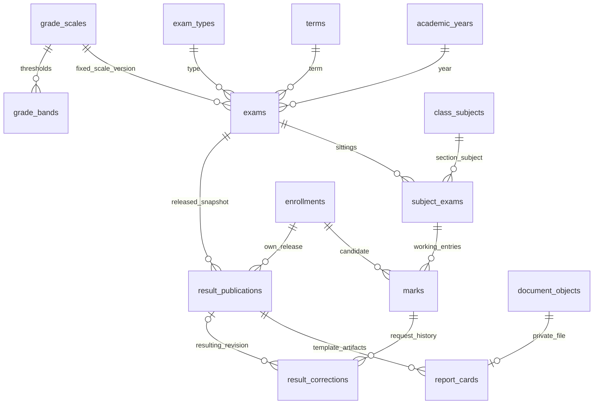
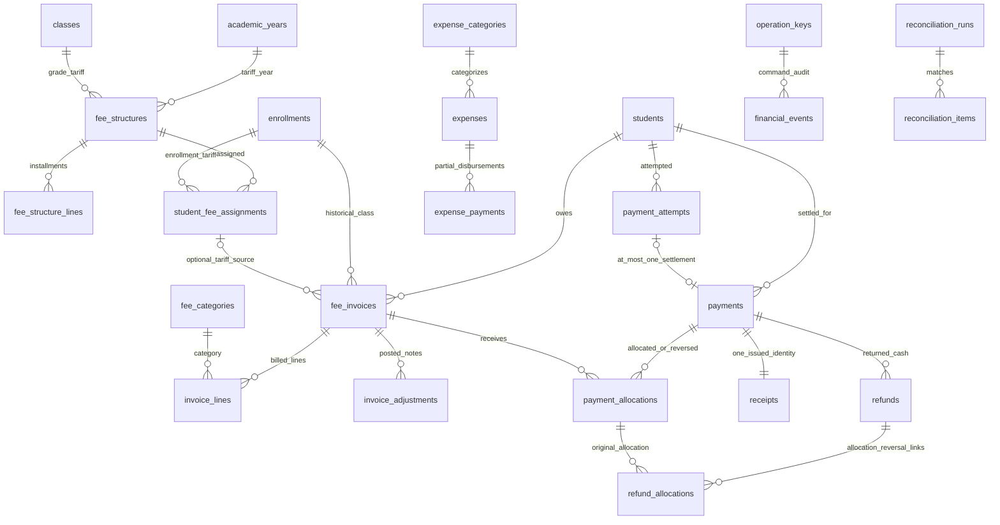
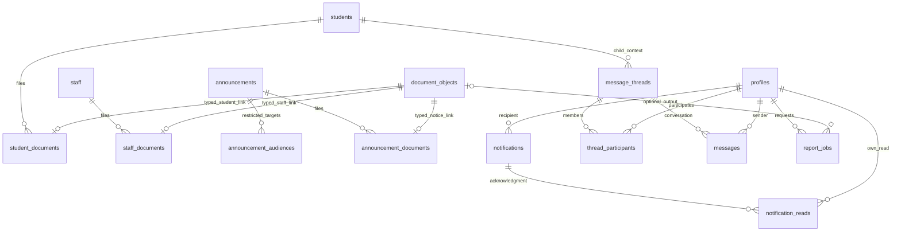

# Domain ERDs — proposed only

## Step 12 current singleton login scope

Owner-approved initial scope: one Student has at most one active explicitly provisioned login-eligible Parent; one Parent login identity is linked to exactly one Student. Exactly two fields remain for each family role: registration number and its independent six-digit PIN. No Parent Login ID, Guardian Reference/ID, extra username, selection step or third field. Student and Parent have separate internal identities/credentials. Multiple children per Parent and multiple independently login-eligible guardians per Student are **deferred**, while richer non-login guardian relationships remain conceptually supported.

The Step 11 multi-guardian BLOCKED finding is **historical for that earlier scope and remains valid**, not erased or disproven. The new singleton policy removes only that specific selection ambiguity; zero, multiple, inactive, revoked, stale or inconsistent mappings deny. Six-digit production security, provider/Supabase sessions, durable throttling and RLS remain unverified. Only Super Admin provisions/manages grants; five primary roles and immutable audit/finance boundaries remain unchanged.

Current local source updates replace the unused guardianReferenceRequired true flag with false and add pure input/cardinality/evidence-state contracts. The model returns no genuine session and is not wired to routes. Existing public mock dashboards, including the Parent two-child demo, remain unchanged and are not production relationship evidence. Any older instructions to retain the true flag or require a multi-child login mapping below are superseded for this initial phase.

See [singleton identity policy](STEP-12-SIMPLIFIED-PARENT-IDENTITY.md), [contracts](STEP-12-AUTH-CONTRACTS.md), [verification](STEP-12-SECURITY-VERIFICATION.md) and [next integration gate](STEP-12-NEXT-INTEGRATION-GATE.md). Statuses remain separate: **LOCAL FOUNDATION COMPLETE**; **ISOLATED PROVIDER PROOF PENDING**; **PRODUCTION AUTHENTICATION NOT APPROVED**. Step 13 has not started.

## Retained earlier architecture and findings

## Step 11 authoritative UX and resolution status — 2026-11-05

The owner approved exactly two fields for each family login: Student Registration Number + six-digit Student PIN; linked Student Registration Number + independent six-digit Parent PIN. **No Guardian Reference/ID field, third input, guardian selection screen, hidden phone/email selector or unapproved extra factor.** Earlier requirements for a guardian reference and their associated successful proof sequences/approval checklists are **superseded**, retained below solely as historical designs. Do not implement or request approval for the old third-field design as if it were current.

The two-field multi-guardian Parent first-login architecture is **C. BLOCKED**: identical allowed inputs cannot distinguish two guardians, and no acceptable distinct-secret resolution protocol meeting the restrictions is established. Student/provider integration remains conditional; six-digit production security remains unapproved. Five roles, Super Admin within Admin, mandatory Super Admin MFA and sole Super Admin provisioning remain unchanged. No UI or live authentication is implemented.

See [current feasibility and sequences](STEP-11-TWO-FIELD-LOGIN-FEASIBILITY.md), [guardian models](STEP-11-GUARDIAN-IDENTITY-MODELS.md), [tests](STEP-11-AUTH-SECURITY-TESTS.md) and [decision gate](STEP-11-DECISION-GATE.md). These take precedence over the rejected reference-based resolution assumptions below; they do not relabel earlier research or tests as a passed proof.

Any earlier proposed guardian login_reference column/uniqueness is no longer a required login input or an approved hidden selector. Internal canonical guardian IDs and verified dated relationships remain necessary. No schema or migration is changed.

## Retained earlier architecture — superseded where stated above

## Step 8 authoritative update

The historical diagrams below omit the proposed admin_privileges (profile 1:0..1), admin_privilege_events (profile 1:many), login_identities (profile 1:many), pin_credential_metadata (profile 1:many), and singleton security_bootstrap_runs relations. These additive relations are specified in the access model. Admin privilege is not a new role node. Existing guardian/student many-to-many links remain authoritative; registration and guardian login-reference uniqueness are required.

Approved role/login/provisioning requirements take precedence over conflicting historical Step 7 text below. Proposed mechanisms are not deployed controls. See [access model](SUPER-ADMIN-ACCESS-MODEL.md), [PIN design](STUDENT-PARENT-PIN-AUTH-DESIGN.md), [bootstrap](SUPER-ADMIN-BOOTSTRAP-PLAN.md) and [threat model](AUTHENTICATION-THREAT-MODEL.md).

## Retained Step 7 blueprint (subject to the update above)

Names refer to the [canonical schema inventory](DATABASE-SCHEMA-BLUEPRINT.md). These diagrams show important FKs, not every metadata/catalog/document/job edge. `o|` permits zero/one; `o{` permits zero/many; `||` requires one. Optional profile links do not create authorization by themselves. Composite year/section/student keys and transactional constraints remain mandatory even where a simple edge is used for readability.

## Identity, people and enrollment

A student has zero/many enrollments over time; placement intervals cannot overlap. `promotions.from_enrollment_id` is unique. Destination is optional only for graduation, required otherwise. Guardian membership is many-to-many with dated access/approval, not an email/name join. Staff→teacher is optional unique extension.

## Teaching, attendance and homework

Published homework needs at least one authorized target; drafts may have none. Records are unique per session/enrollment, submissions per homework/enrollment/attempt. The class/subject/year and effective teacher assignment are validated together, not merely independent FKs.

## Examinations and publication

Publications are per exam/enrollment/revision and contain validated immutable snapshots of approved marks. Families query publications, not the working marks table. Corrections require a new released revision; report artifacts refer to that exact revision.

## Finance

One settled payment belongs to one student in the initial design, may pay many of that student's invoices, and gets one immutable receipt identity in the posting transaction. Counter uniqueness + transaction enforce receipt 1:1; no direct payment inserts. Refund links point to original and reversal allocations; they are not a second balance adjustment. Expense obligations have zero/many partial paid events. Reconciliation items point to exactly one payment/refund/expense-payment cash fact.

## Documents, messaging and jobs

At most one typed parent purpose per object is a command/manifest integrity rule across document links, not independently implied by each edge. Notification read's profile must equal recipient. Thread participation additionally requires a currently authorized child relationship. Job output access is reauthorized, not granted by the existence of a file UUID.
