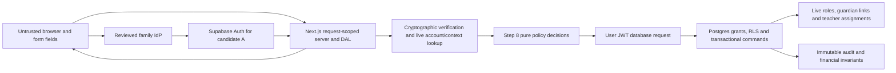

# Session and RLS trust boundaries — Step 9

## Step 12 current singleton login scope

Owner-approved initial scope: one Student has at most one active explicitly provisioned login-eligible Parent; one Parent login identity is linked to exactly one Student. Exactly two fields remain for each family role: registration number and its independent six-digit PIN. No Parent Login ID, Guardian Reference/ID, extra username, selection step or third field. Student and Parent have separate internal identities/credentials. Multiple children per Parent and multiple independently login-eligible guardians per Student are **deferred**, while richer non-login guardian relationships remain conceptually supported.

The Step 11 multi-guardian BLOCKED finding is **historical for that earlier scope and remains valid**, not erased or disproven. The new singleton policy removes only that specific selection ambiguity; zero, multiple, inactive, revoked, stale or inconsistent mappings deny. Six-digit production security, provider/Supabase sessions, durable throttling and RLS remain unverified. Only Super Admin provisions/manages grants; five primary roles and immutable audit/finance boundaries remain unchanged.

Current local source updates replace the unused guardianReferenceRequired true flag with false and add pure input/cardinality/evidence-state contracts. The model returns no genuine session and is not wired to routes. Existing public mock dashboards, including the Parent two-child demo, remain unchanged and are not production relationship evidence. Any older instructions to retain the true flag or require a multi-child login mapping below are superseded for this initial phase.

See [singleton identity policy](STEP-12-SIMPLIFIED-PARENT-IDENTITY.md), [contracts](STEP-12-AUTH-CONTRACTS.md), [verification](STEP-12-SECURITY-VERIFICATION.md) and [next integration gate](STEP-12-NEXT-INTEGRATION-GATE.md). Statuses remain separate: **LOCAL FOUNDATION COMPLETE**; **ISOLATED PROVIDER PROOF PENDING**; **PRODUCTION AUTHENTICATION NOT APPROVED**. Step 13 has not started.

## Retained earlier architecture and findings

## Step 11 authoritative UX and resolution status — 2026-11-05

The owner approved exactly two fields for each family login: Student Registration Number + six-digit Student PIN; linked Student Registration Number + independent six-digit Parent PIN. **No Guardian Reference/ID field, third input, guardian selection screen, hidden phone/email selector or unapproved extra factor.** Earlier requirements for a guardian reference and their associated successful proof sequences/approval checklists are **superseded**, retained below solely as historical designs. Do not implement or request approval for the old third-field design as if it were current.

The two-field multi-guardian Parent first-login architecture is **C. BLOCKED**: identical allowed inputs cannot distinguish two guardians, and no acceptable distinct-secret resolution protocol meeting the restrictions is established. Student/provider integration remains conditional; six-digit production security remains unapproved. Five roles, Super Admin within Admin, mandatory Super Admin MFA and sole Super Admin provisioning remain unchanged. No UI or live authentication is implemented.

See [current feasibility and sequences](STEP-11-TWO-FIELD-LOGIN-FEASIBILITY.md), [guardian models](STEP-11-GUARDIAN-IDENTITY-MODELS.md), [tests](STEP-11-AUTH-SECURITY-TESTS.md) and [decision gate](STEP-11-DECISION-GATE.md). These take precedence over the rejected reference-based resolution assumptions below; they do not relabel earlier research or tests as a passed proof.

## Retained earlier architecture — superseded where stated above

## Step 10 current preference and proof status — 2026-11-05

Six-digit preference changes neither session provenance nor live authorization requirements. No PIN result, valid format or branded object establishes identity. Real verified Auth session, live role/context/version and per-request guardian/assignment RLS checks remain mandatory; limiter state and external-event freshness are additional proof boundaries.

This update takes precedence for the current UX and proof scope; it does not rewrite the historical findings below as a passed security proof. See [six-digit risk assessment](STEP-10-SIX-DIGIT-PIN-RISK-ASSESSMENT.md), [controlled proof plan](STEP-10-AUTH-PROOF-PLAN.md), [security matrix](STEP-10-SECURITY-TEST-MATRIX.md) and [owner checklist](STEP-10-OWNER-APPROVAL-CHECKLIST.md). Exactly five roles and the existing Super Admin model are unchanged.

## Retained Step 9 analysis

Checked 2026-11-05. Planning only; no SQL, helper or policy is deployed. See the dated [evidence register](STEP-9-AUTH-FEASIBILITY.md#evidence-register) and [decision gate](STEP-9-DECISION-GATE.md).

## Distinct responsibilities

Authentication proves control of an authenticator at a provider. Identity verification binds that provider identity to the school-reviewed person/provisioning intent; a valid login alone does not prove guardianship. Role authorization selects one current allowed school membership and operation. Row authorization limits that operation to current own/child/assigned records and workflow state. Database access additionally requires grants, a correctly authenticated connection and RLS/command enforcement. None follows from a dashboard URL or TypeScript type.



## Native and candidate A session boundary

Use a request-scoped provider client. Cookies/token decoding alone do not establish identity. Validate the correct project's issuer, intended audience, allowed algorithm/key, time bounds and UUID subject/session; use documented token verification and current-user checks as required. Signature verification and a current Auth user are distinct from current application authorization. Only after resolving live account/reset state, approved canonical binding, membership, privilege/MFA, authorization version and role_context may a future server adapter construct Step 8's trusted input. The opaque brand/source string cannot authenticate a cast object. [Token verification](https://supabase.com/docs/reference/javascript/auth-getclaims), [current user](https://supabase.com/docs/reference/javascript/auth-getuser), [claim definitions](https://supabase.com/docs/guides/auth/jwt-fields).

Maintain exactly one active school role per Auth session, with server-owned context version/expiry and explicit membership. Switching atomically invalidates stale requests and clears previous-role UI data; no union across memberships or user-set role cookies. Super Admin tier requires active Admin membership and genuine MFA; broad module review remains an Admin projection. Ordinary Admin cannot perform IAM even if a forged client claim lists security permissions.

Next.js Proxy may coordinate refresh/navigation, but each server action, handler and DAL query checks authorization. RLS remains necessary for direct Data API/Storage access. The installed Next guides require this separation. Cookie refresh must propagate both request and response updates, preserve cache headers and avoid shared CDN/ISR caching of private output. Native SSR client guidance uses cookies; do not claim all library cookies are HttpOnly by default. Before implementation choose either the documented browser-readable client model with explicit XSS/CSP controls, or a separately reviewed server-only BFF model with Secure/HttpOnly session cookies and no browser refresh-token access. Use deliberate SameSite/path/domain rules, HTTPS, CSRF/origin protection on mutations, safe redirect allowlists and no token logging. [SSR guidance](https://supabase.com/docs/guides/auth/server-side/nextjs), [session security](https://cheatsheetseries.owasp.org/cheatsheets/Session_Management_Cheat_Sheet.html).

## Refresh and revocation are different

Provider session renewal cannot silently renew revoked school access. On every protected request RLS/commands require current account and application session/context versions. Logout revokes context before clearing client state; reset, suspension, role/tier changes and guardian restrictions revoke affected contexts atomically with authoritative school state changes. A supported outbox/reconciliation workflow then handles nontransactional provider invalidation. Failure to reach the provider must not restore application access. Token expiry provides a bound, not an immediate revoke mechanism. Native refresh rotation and signout semantics are documented; federation does not prove that IdP password reset/logoff kills a downstream Supabase refresh token. [Sessions](https://supabase.com/docs/guides/auth/sessions), [signout](https://supabase.com/docs/guides/auth/signout).

Define an operator path for out-of-band provider bans/resets and signed events or reconciliation; require an approved freshness target and fail-closed behavior on stale state. Reauthentication time must be derived from genuine verified authentication/challenge evidence; token iat or routine refresh is not proof of a fresh factor. Step 8's timestamp is an input assumption, not a completed integration.

## RLS compatibility by option

| Identity fact | A — OIDC through Auth / B — native / D — native UX change | C — external JWT |
| --- | --- | --- |
| Issuer | Intended Supabase Auth project issuer; upstream issuer/subject separately preapproved | Explicit allowlist of external issuers; never subject-only mapping |
| Audience | Intended project Auth audience, normally authenticated for signed-in user; exact configuration validated | Resource audience must match approved API; custom integration's configurable audience enforcement is **unverified** in reviewed docs and must be confirmed/tested before adoption |
| Subject | Genuine Auth UUID bound to approved school profile | External stable text sub plus issuer mapped uniquely to canonical school profile; UUID appearance alone does not establish Auth-user FK |
| auth.uid() | Uses verified Auth UUID; null/absent identity denies | Casts sub to UUID; non-UUID fails. Even UUID external sub is not automatically an auth.users identity |
| Postgres role | authenticated is DB connection role, not school role | Signed role authenticated required; absent role is anon; never allow externally supplied service_role/admin role |
| Active school role | Protected role_context keyed to genuine user/session UUID | Requires new protected external session/context model; no fabricated Supabase session_id |
| Assurance | Genuine native aal2 plus live Super Admin tier for privileged access | Provider assurance/AMR mapping requires audited semantics; external aal-looking text cannot be assumed equivalent |
| Refresh ownership | Supabase session client | External IdP SDK; Auth getSession/getUser/refresh behavior is not interchangeable |
| Suspension/revocation | Live application state and context/version checks, not token signature alone | Same live denial plus provider-specific session revocation/freshness contract |
| School rows | Own Student, verified guardian scope, effective Teacher assignments, finance grants/workflow | Same predicates after canonical identity mapping; all helper paths need redesign/review |

Third-party JWT configuration uses the provider token through the documented SDK accessToken callback; it does not translate a JWT into a Supabase Auth session. Issuer collisions and key-rotation delays must be modeled. No direct database connection is authenticated merely by presenting a browser JWT; use the supported gateway/user-JWT API or a separately reviewed DB access design. [External OIDC identity semantics](https://supabase.com/docs/guides/auth/third-party/custom-oidc).

## Required custom application policy — pseudocode only

```text
DENY unless provider token verified for intended issuer/audience/resource
AND canonical school identity binding is preapproved and active
AND account active, credential reset complete, authorization version current
AND this verified session owns a current nonrevoked active-role context
AND requested known operation is granted within the active role ceiling
AND (Student => row belongs to linked Student)
AND (Parent => dated verified guardian relationship allows requested purpose)
AND (Teacher => effective class/subject assignment permits row)
AND (Accountant => explicit finance grant and permitted record projection)
AND (Super Admin operation => live Admin tier + genuine MFA + required step-up)
AND workflow state and integrity constraints hold
```

Future custom helpers/commands are required for context selection, active memberships, live account/tier/version checks, approved relationships, sensitive approvals and immutable transactions. Review definer ownership/search_path, recursion, grants, indexes, restrictive vs permissive policy composition and view/storage/realtime paths. A token hook can carry bounded hints, but must not replace these live predicates or become a PIN grant. User-editable metadata is never a grant. [RLS guidance](https://supabase.com/docs/guides/database/postgres/row-level-security), [access-token hooks](https://supabase.com/docs/guides/auth/auth-hooks/custom-access-token-hook).

## Required future negative tests

Wrong signature/algorithm/key/issuer/audience; expired/future/replayed token; unapproved subject; automatic email cross-link; direct API requests without context; wrong active role; stale tab/context version; reset-required/suspended account; old token after revocation; unrelated or revoked child; ended teacher assignment; Accountant reading sensitive Student fields; Super Admin aal1; self-approval; last-admin concurrent removal; settled/audit update/delete; private file access; browser cookie theft/CSRF/cache leakage. Execute under ordinary user identities, not a service-role bypass. None was executed live in Step 9.
