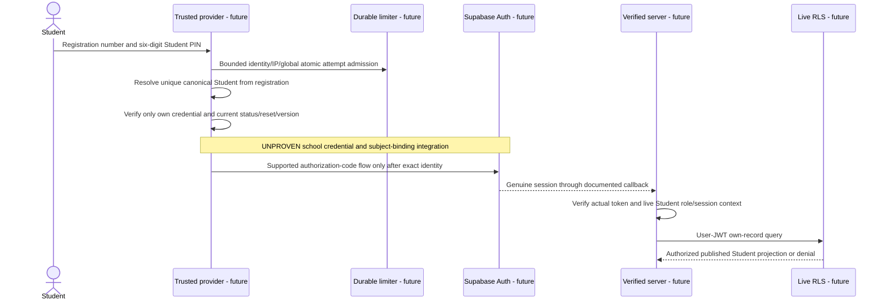

# Step 11 — Two-field login feasibility

## Step 12 current singleton login scope

Owner-approved initial scope: one Student has at most one active explicitly provisioned login-eligible Parent; one Parent login identity is linked to exactly one Student. Exactly two fields remain for each family role: registration number and its independent six-digit PIN. No Parent Login ID, Guardian Reference/ID, extra username, selection step or third field. Student and Parent have separate internal identities/credentials. Multiple children per Parent and multiple independently login-eligible guardians per Student are **deferred**, while richer non-login guardian relationships remain conceptually supported.

The Step 11 multi-guardian BLOCKED finding is **historical for that earlier scope and remains valid**, not erased or disproven. The new singleton policy removes only that specific selection ambiguity; zero, multiple, inactive, revoked, stale or inconsistent mappings deny. Six-digit production security, provider/Supabase sessions, durable throttling and RLS remain unverified. Only Super Admin provisions/manages grants; five primary roles and immutable audit/finance boundaries remain unchanged.

Current local source updates replace the unused guardianReferenceRequired true flag with false and add pure input/cardinality/evidence-state contracts. The model returns no genuine session and is not wired to routes. Existing public mock dashboards, including the Parent two-child demo, remain unchanged and are not production relationship evidence. Any older instructions to retain the true flag or require a multi-child login mapping below are superseded for this initial phase.

See [singleton identity policy](STEP-12-SIMPLIFIED-PARENT-IDENTITY.md), [contracts](STEP-12-AUTH-CONTRACTS.md), [verification](STEP-12-SECURITY-VERIFICATION.md) and [next integration gate](STEP-12-NEXT-INTEGRATION-GATE.md). Statuses remain separate: **LOCAL FOUNDATION COMPLETE**; **ISOLATED PROVIDER PROOF PENDING**; **PRODUCTION AUTHENTICATION NOT APPROVED**. Step 13 has not started.

## Retained earlier architecture and findings

Checked **2026-11-05**. Current approved UI structure has exactly two fields in each family login: **Student Registration Number + six-digit Student PIN**; **linked Student Registration Number + six-digit Parent PIN**. No Guardian Reference/ID, extra input, guardian selection screen, invisible identity selector or added factor is part of this design. The six-digit credential remains a preference, not production security approval.

**Parent two-field multi-guardian first login: C. BLOCKED.** Student resolution is structurally simpler but remains conditional on six-digit risk acceptance, actual provider/session proof and RLS. No login page, server, dependency, credential, token, database or external integration is created.

## Actual implementation and preservation boundary

Inspected README, Steps 7–10 reports, all twenty-seven existing architecture documents, all auth library files/tests, the five dashboard features and App Router pages/layouts, package/TypeScript configuration and comments-only environment template. Current routes remain public fictional previews. Auth code consists of pure authorization decisions over supplied evidence, not a provider verifier or successful-login factory. Existing application source and historical reports are preserved.

One explicit legacy mismatch is retained in code: `LOGIN_METHODS.parent_registration_pin.guardianReferenceRequired` is `true` from Step 8. It is unused by pages and does not add an input field. It is **superseded metadata for a rejected proposed resolver**, not the current UX contract. Do not wire it to a form or treat the old metadata/tests as evidence of a valid two-field resolver. No adapter can safely substitute the blocked new model. Preserve source now; any future approved resolver must reconcile that obsolete metadata with a documented contract change before integration. All other five-role, credential-separation and fail-closed policy contracts remain applicable.

## Six-digit threat assessment and controls

Six random decimal digits give one million values and about 19.93 bits. Registration is an exposed identifier and Parent role is common to all guardians, so neither adds secret entropy. PIN reuse, observation, phishing/shared devices, distributed/low-and-slow guessing, offline verifier theft and school support impersonation remain material risks. Rotation/reset can introduce ambiguity; a limiter cannot tell which guardian to debit before resolution. Parent-scoped attack budgets also let attackers lock out an entire family scope.

Keep candidate controls: independent random credentials and salts, provider-owned memory-hard verification, confidential activation, approved initial-change policy, persistent atomic pre-resolution/identity/IP/global budgets, campaign detection, bounded backoff, outage denial, verified recovery, current account status and live version/context revocation. They are unimplemented and cannot remove low entropy or select an intended guardian from identical information. A valid credential format is not authentication; shared PIN values never authorize merged identities.

NIST's [authenticator requirements](https://pages.nist.gov/800-63-4/sp800-63b/authenticators/) distinguish remote numeric passwords from local activation PINs, and specify 15-character single-factor or at least eight-character MFA password baselines. Six remote digits fall below both; an added factor would not automatically make that password conformant. No certification/applicability claim is made. The single-page NIST fetch timed out during Step 11; the official section page was successfully reviewed. Stronger credentials, approved cryptographic authentication or additional verified evidence need explicit owner decisions; no change is adopted silently.

## Current official capability evidence

All URLs below checked 2026-11-05. Status is for a documented primitive only; the school composition remains untested. No public documentation establishes the required two-field multi-guardian resolver.

| Area / official source | Documented capability | Limitation / required future control |
| --- | --- | --- |
| [Native Supabase login](https://supabase.com/docs/guides/auth/passwords) | Email/phone password sign-in and recovery | Not a registration/unknown-guardian PIN resolver; no alias trick or custom exchange established |
| [Custom OIDC through Auth](https://supabase.com/docs/guides/auth/custom-oauth-providers) | Custom provider code flow, discovery/JWKS, optional email | Upstream must already authenticate an exact subject; configure trusted issuer/client/callback and prove binding |
| [Third-party JWT](https://supabase.com/docs/guides/auth/third-party/custom-oidc) | External signed token access with issuer configuration and SDK token callback | Not a native Auth session; issuer/sub and session model redesign required; non-UUID sub breaks auth.uid |
| [OIDC Core](https://openid.net/specs/openid-connect-core-1_0.html) | Identity assertions based on issuer authentication, subject and audience | Does not resolve ambiguity upstream; assertion validity cannot repair wrong person selection |
| [Identity linking](https://supabase.com/docs/guides/auth/auth-identity-linking) | Automatic same-email and manual linking | Must prove no guardian/Student/staff cross-link or unauthorized subject creation; shared contact is insufficient |
| [Sessions](https://supabase.com/docs/guides/auth/sessions) | Native access/refresh lifecycle and session_id | Upstream and downstream lifecycles differ; real refresh, reset and suspension propagation must be tested |
| [Signout](https://supabase.com/docs/guides/auth/signout) | Scoped refresh-session invalidation | Existing access tokens can remain valid to expiry; live app context must enforce earlier denial |
| [MFA](https://supabase.com/docs/guides/auth/auth-mfa) | Factor challenge and assurance enforcement | Super Admin requires genuine mandatory native MFA plus application tier checks; no assumed upstream aal translation |
| [Token verification](https://supabase.com/docs/reference/javascript/auth-getclaims) | Verify claims using trusted signing configuration | Token decoding/branding is not proof; signature validity is distinct from live role/link status |
| [RLS](https://supabase.com/docs/guides/database/postgres/row-level-security) | Row predicates using authenticated identity/claims | Custom live guardian/Teacher/finance/context policies required; user metadata and stale JWT grants cannot replace live state |
| [Keycloak extension model](https://www.keycloak.org/docs/latest/server_development/index.html#_auth_spi) | Custom authenticator/credential extension points | Internal SPI risk; exact permitted resolver, collision mechanism and lifecycle protocol unverified |
| [WebAuthn](https://www.w3.org/TR/webauthn-3/) | Cryptographic account-bound authentication | Extra enrollment/interaction/recovery or account choice requires explicit approval; not unchanged two-input login |

No SQL/helper/policy is supplied or executed. No invented provider endpoint, homemade JWT or PIN-success cookie is proposed. Only an actual supported provider session plus live canonical account/membership/context/relationships could supply Step 8's trusted server input. Super Admin remains within Admin, with no sixth role/route, no ordinary Admin provisioning and no financial/audit bypass. Public self-registration must be disabled in any future integration; no provider configuration currently exists to toggle it.

## Proposed Student sequence — not implemented



Bound registration normalization as a string, preserve leading zeroes, use explicit school case/format policy and never infer admission-number equivalence. PIN is exactly six ASCII digits, never stored here. Unknown identity/wrong credential/reset-required/suspension or unavailable limiter fails generically. Attempts must be admitted before expensive comparison; recheck current state/version before issuing authority. The school must provision unique canonical Student identities; registration alone is not authentication.

Refresh uses supported native lifecycle while live app state/context is checked each request. Logout revokes context and uses explicit provider signout scope, clears private state and separately handles upstream SSO policy. Suspension/reset changes authoritative versions first, denies old sessions under RLS and reconciles nontransactional provider invalidation. No claim that IdP reset alone kills a downstream refresh token. These are future tests, not implemented controls.

## Parent sequences — interpretation

Every diagram below shows attempt limiting, exact-resolution outcome, credential-verification status, session binding and live authorization. All provider/limiter/RLS steps are **unimplemented**. A conditional singleton path illustrates only a restricted case; it cannot be generalized into a multi-guardian success. For unresolved multi-guardian requests, fail closed **before comparing candidate credentials**, issue no session, expose no guardian information and allow no protected data. Generic failures must not reveal candidate count; timing/rate-limit behavior also needs future measurement.


### P01 — One guardian, one child

Protected current records show exactly one eligible guardian for this registration. This narrow assumption is explicit; it is not a new one-guardian policy.

```mermaid
sequenceDiagram
    actor Parent
    participant P as Future trusted provider
    participant L as Future durable limiter
    participant A as Future Auth and server
    participant R as Future live RLS
    Parent->>P: Linked registration and own six-digit Parent PIN only
    P->>L: Atomic registration/IP/global budget before resolution
    P->>P: Singleton exact guardian candidate
    P->>P: Verify only that identity credential and active state - UNPROVEN
    Note over P,A: Conditional singleton illustration only; integration UNPROVEN
    P->>A: Supported Auth session binds only that verified subject - UNPROVEN
    A->>R: Live exact guardian-child purpose and version checks - UNPROVEN
    R-->>Parent: Safe projection only if every gate succeeds; otherwise deny
```

### P02 — One guardian, multiple children

Each submitted child alias must currently have one eligible candidate matching the same canonical guardian. If any alias has another eligible guardian, use the blocked path instead. One canonical identity, credential and attempt budget spans all approved aliases.

```mermaid
sequenceDiagram
    actor Parent
    participant P as Future trusted provider
    participant L as Future durable limiter
    participant A as Future Auth and server
    participant R as Future live RLS
    Parent->>P: Linked registration and own six-digit Parent PIN only
    P->>L: Atomic registration/IP/global budget before resolution
    P->>P: Singleton alias maps to existing canonical guardian
    P->>P: Verify one own credential with shared canonical budget - UNPROVEN
    Note over P,A: Conditional singleton illustration only; integration UNPROVEN
    P->>A: Same guardian Auth subject through either alias - UNPROVEN
    A->>R: Recheck every selected child and current link independently - UNPROVEN
    R-->>Parent: Safe projection only if every gate succeeds; otherwise deny
```

### P03 — Two guardians, one child, distinct PINs

Distinct credential values would permit a mathematical inverse, but no acceptable resolution protocol is established. Do not try both hashes, build a secret directory, or pick a guardian.

```mermaid
sequenceDiagram
    actor Parent
    participant P as Future trusted provider
    participant L as Future durable limiter
    participant A as Future Auth and server
    participant R as Future live RLS
    Parent->>P: Linked registration and own six-digit Parent PIN only
    P->>L: Atomic registration/IP/global budget before resolution
    P->>P: Multiple eligible identities; exact resolver BLOCKED
    P->>P: Credential comparison NOT ATTEMPTED; no candidate search
    Note over P,A: NO session or subject binding
    Note over A,R: NO protected child data; live authorization never reached
    P-->>Parent: Generic denial; no guardian list or identity hint
```

### P04 — Two guardians with the same PIN

Both possible claimants supply identical allowed inputs. No algorithm can recover which guardian intended to log in without independent evidence. Do not verify candidates to discover a collision; deny the unresolved scope before comparisons.

```mermaid
sequenceDiagram
    actor Parent
    participant P as Future trusted provider
    participant L as Future durable limiter
    participant A as Future Auth and server
    participant R as Future live RLS
    Parent->>P: Linked registration and own six-digit Parent PIN only
    P->>L: Atomic registration/IP/global budget before resolution
    P->>P: Multiple identities and potentially identical input; BLOCKED
    P->>P: Credential comparison NOT ATTEMPTED
    Note over P,A: NO session; never arbitrary or shared subject
    Note over A,R: NO protected data; existing sessions remain separately authorized
    P-->>Parent: Generic denial; no guardian list or identity hint
```

### P05 — Guardian PIN reset

Only a previously verified Super Admin-controlled recovery workflow may identify the canonical target from approved school evidence. It is a separate governed operation, not an invisible identity selector in login. Reset collisions/uniqueness remain unresolved for Model A. Invalidate old authority; do not promise a successful new two-field multi-guardian login.

```mermaid
sequenceDiagram
    actor Parent
    participant P as Future trusted provider
    participant L as Future durable limiter
    participant A as Future Auth and server
    participant R as Future live RLS
    Parent->>P: Linked registration and own six-digit Parent PIN only
    P->>L: Atomic registration/IP/global budget before resolution
    P->>P: New login still has unresolved multi-guardian identity
    P->>P: Reset cannot justify candidate hash scanning; NOT ATTEMPTED
    Note over P,A: Old target contexts revoked; NO new login session
    Note over A,R: Live revoked-version checks deny old target authority - UNPROVEN
    P-->>Parent: Generic denial; no guardian list or identity hint
```

### P06 — Guardian account suspension

A verified administrative command must suspend the exact already-established canonical target and invalidate its contexts. Removing an eligible candidate must not reinterpret a leaked old PIN as a different guardian; the full Model A lifecycle is unresolved.

```mermaid
sequenceDiagram
    actor Parent
    participant P as Future trusted provider
    participant L as Future durable limiter
    participant A as Future Auth and server
    participant R as Future live RLS
    Parent->>P: Linked registration and own six-digit Parent PIN only
    P->>L: Atomic registration/IP/global budget before resolution
    P->>P: Multi-guardian fresh resolution remains BLOCKED
    P->>P: Suspended authority denies; no candidate comparisons
    Note over P,A: Old suspended context rejected; NO new session
    Note over A,R: Live active-account and guardian checks must deny - UNPROVEN
    P-->>Parent: Generic denial; no guardian list or identity hint
```

### P07 — Guardian relationship revocation

A verified relationship-management command identifies the existing guardian/child pair, ends that dated link and bumps affected versions. This does not establish who submits a later ambiguous PIN. Other approved child scopes remain independent.

```mermaid
sequenceDiagram
    actor Parent
    participant P as Future trusted provider
    participant L as Future durable limiter
    participant A as Future Auth and server
    participant R as Future live RLS
    Parent->>P: Linked registration and own six-digit Parent PIN only
    P->>L: Atomic registration/IP/global budget before resolution
    P->>P: Revoked alias cannot resolve an authorized identity
    P->>P: Credential check NOT ATTEMPTED on revoked/unresolved alias
    Note over P,A: NO new session; affected old context invalidated
    Note over A,R: Live relationship/version denies revoked child - UNPROVEN
    P-->>Parent: Generic denial; no guardian list or identity hint
```

### P08 — Student withdrawal

Default new-login alias eligibility ends. Historical record rights need explicit dated policy and a valid independently authenticated path; retaining history does not grant access or identify a guardian.

```mermaid
sequenceDiagram
    actor Parent
    participant P as Future trusted provider
    participant L as Future durable limiter
    participant A as Future Auth and server
    participant R as Future live RLS
    Parent->>P: Linked registration and own six-digit Parent PIN only
    P->>L: Atomic registration/IP/global budget before resolution
    P->>P: Withdrawn alias ineligible; no authorized resolution
    P->>P: Credential verification NOT ATTEMPTED
    Note over P,A: NO new session; prior context scope must be reevaluated
    Note over A,R: Live enrollment/link policy denies alias scope - UNPROVEN
    P-->>Parent: Generic denial; no guardian list or identity hint
```

### P09 — First login on a new device

No prior verified subject exists. Do not infer identity from device fingerprint, localStorage, phone or email. A multi-guardian scope cannot rely on Model B.

```mermaid
sequenceDiagram
    actor Parent
    participant P as Future trusted provider
    participant L as Future durable limiter
    participant A as Future Auth and server
    participant R as Future live RLS
    Parent->>P: Linked registration and own six-digit Parent PIN only
    P->>L: Atomic registration/IP/global budget before resolution
    P->>P: No trusted prior identity; multi-guardian resolver BLOCKED
    P->>P: Credential check NOT ATTEMPTED across candidates
    Note over P,A: NO session; no remembered guardian bootstrap
    Note over A,R: NO child data; no fabricated relationship context
    P-->>Parent: Generic denial; no guardian list or identity hint
```

### P10 — Shared family device

A genuinely valid prior session can continue only its own subject after live checks; it cannot prove which person now types the two fields. A request to switch guardians must not silently bind to the remembered user. Logout clears context; new ambiguous login remains blocked.

```mermaid
sequenceDiagram
    actor Parent
    participant P as Future trusted provider
    participant L as Future durable limiter
    participant A as Future Auth and server
    participant R as Future live RLS
    Parent->>P: Linked registration and own six-digit Parent PIN only
    P->>L: Atomic registration/IP/global budget before resolution
    P->>P: Cookie cannot select intended new guardian; BLOCKED
    P->>P: No PIN check against remembered or candidate guardian by guess
    Note over P,A: NO new login session or silent subject substitution
    Note over A,R: Existing verified subject gets only its live scope; no new child access
    P-->>Parent: Generic denial; no guardian list or identity hint
```

### P11 — Unknown registration number

Bound parsing and registration/IP/global budgets apply before expensive work. Generic response shape and bounded dummy handling must be measured for enumeration resistance; do not list enrollment or guardian information.

```mermaid
sequenceDiagram
    actor Parent
    participant P as Future trusted provider
    participant L as Future durable limiter
    participant A as Future Auth and server
    participant R as Future live RLS
    Parent->>P: Linked registration and own six-digit Parent PIN only
    P->>L: Atomic registration/IP/global budget before resolution
    P->>P: No approved identity resolved
    P->>P: No real credential comparison; bounded dummy work only - UNPROVEN
    Note over P,A: NO Auth session or application context
    Note over A,R: NO protected records or files
    P-->>Parent: Generic denial; no guardian list or identity hint
```

## Scope of the result

The diagrams are designs, not new code or proof results. No ambiguous path is labeled successful. Existing valid-session revocation and singleton behavior are separate from resolving first login for all required multi-guardian cases. Student feasibility remains conditional; Parent multi-guardian new-session design is blocked. The [model comparison](STEP-11-GUARDIAN-IDENTITY-MODELS.md), [test plan](STEP-11-AUTH-SECURITY-TESTS.md) and [gate](STEP-11-DECISION-GATE.md) record what evidence or explicit requirement changes would be needed. Step 12 has not started.
