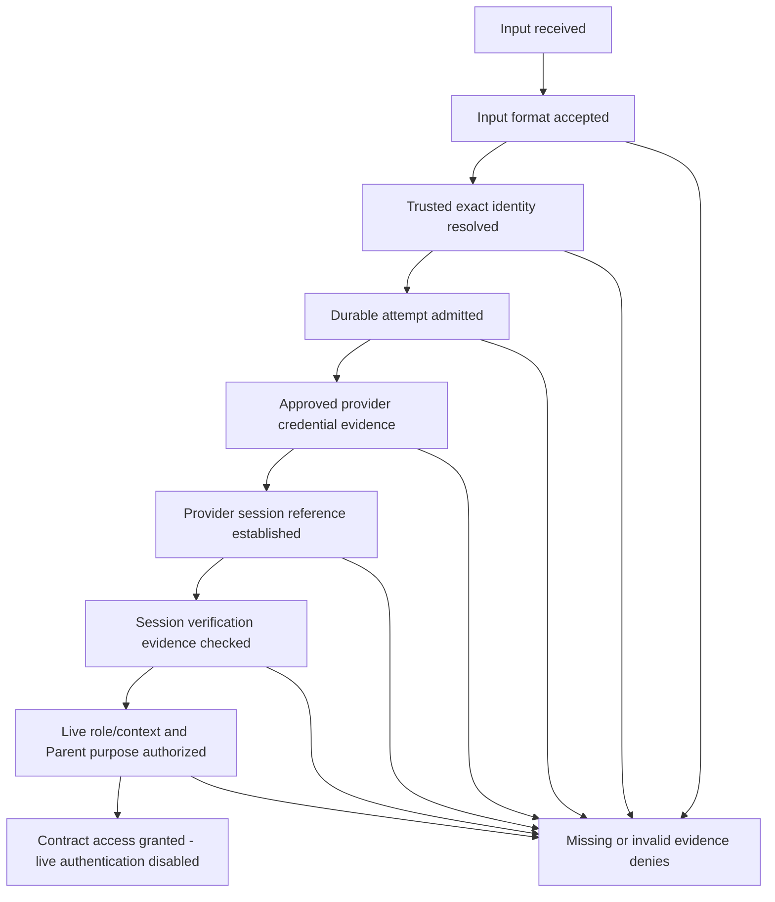

# Step 12 — Local authentication contracts

These strict TypeScript contracts are pure local assessments, not live authentication. No Supabase/provider client, network call, credential verifier, JWT signer, cookie writer, lookup implementation or durable limiter exists. All are isolated under `src/lib/auth/`; no dashboard imports them. No dependency was added.

## Inputs and identifiers

`input-contracts.ts` defines `RegistrationNumberPolicy`, `normalizeRegistrationNumber`, `isSixDigitPinFormat` and `assessFamilyLoginInput`.

Registration safety rejects nonstrings, empty values, control/non-ASCII characters, whitespace and more than 128 characters. The hard ceiling and conservative printable-ASCII transport gate are **not a school format**. A real registration-number format is unknown. An explicitly supplied school-approved policy must specify its identity, bounded maximum and deterministic exact-value predicate; absent, malformed or throwing policy denies. The test policy is synthetic, not a production specification. Registration remains an exact case-sensitive string, with significant leading zeroes, no trimming/Unicode normalization/case folding. A future school needing spaces/Unicode must explicitly review and change this initial contract rather than silently normalize identifiers. Never log complete identifiers or return them in errors.

PIN format requires exactly six ASCII digits as a string. Leading zeros are valid; letters, spaces/newlines, Unicode lookalikes, numbers and other types deny. No trim, conversion, storage, hashing or authentication occurs. Input results contain registration/method/policy metadata only, no PIN; denial results contain static reason codes, no reflected values. Parameters exist transiently during validation only. A format pass is not trusted identity.

## Singleton resolution

`parent-identity.ts` defines canonical provider subjects, Student/candidate states, opaque complete lookup snapshots, the future `ParentIdentityLookup` interface and `resolveInitialParent`. The pure function checks cardinality, forward/reverse eligibility, separate identities, provisioning/account/relationship state, timestamps and versions. See the [identity policy](STEP-12-SIMPLIFIED-PARENT-IDENTITY.md). No function issues a snapshot brand or queries a database.

`LOGIN_METHODS.parent_registration_pin.guardianReferenceRequired` is now **false**, and `initialRelationshipPolicy` is `one-student-one-parent-login`. This explicitly replaces Step 8's unused true flag. The five-role catalog, existing role ceilings, security operations, immutable financial/audit rules and dashboard destination code are unchanged.

## Ordered authentication-state assessment

`evaluateAuthenticationAttempt` evaluates this ordered model from evidence. It never performs any step externally. A denied result records only completed stage labels and a categorical reason. `contract_access_granted` contains no token, identity, session, cookie or authenticated context, and always has `liveAuthenticationEnabled: false`. It is compile-time incompatible with the existing `AuthenticationResult`. `LIVE_AUTHENTICATION_ENABLED` is false; do not wire the model result into route authorization. Real login remains blocked pending the integration gate.

Fresh-login checks bind every stage to attempt ID, registration, role, profile, canonical issuer/subject, credential reference/version and timing. They require active school-provisioned identity, no pending reset, current identity/credential versions, complete current Parent resolution when applicable, admitted durable attempt, verified credential outcome, session issuer/audience/signature/expiry/revocation evidence, and a matching live `VerifiedServerContext`. Context session ID/authentication time/version and dashboard permission must match. Parent additionally requires current relationship version, explicit academic/fees purpose and exact live guardian-child authorization; a fees-only grant does not grant academics.

Missing stages deny in order; input alone stops before identity, lookup alone stops before attempt admission, and verified credential without session evidence denies. Fresh login timing cannot be replaced by token refresh timestamps. A future refresh/continuation adapter must separately verify actual supported lifecycle behavior and live revocation; no refresh logic is implemented here.

## Provider boundary and trust

Opaque `TrustedFamilyIdentity`, `DurableAttemptAdmission`, `ApprovedCredentialEvidence` and `VerifiedProviderSessionEvidence` types describe future trusted evidence. Adapter contracts cover canonical subject, issuer/audience, role, account/reset state, current versions, admitted/rejected/unavailable attempts, verified/rejected/unavailable credential outcomes, session expiry/revocation and verified live context. Provider failures have categorical types. There are no production constructors or adapter implementations.

Canonical provider evidence must refer to the actual issuer/subject of the verified target session. If an external OIDC issuer feeds Supabase Auth, the future adapter must prove upstream subject → intended downstream Auth UUID/profile mapping separately. A custom PIN result or external JWT does not become a Supabase Auth session by filling these fields. Exact compatibility remains unverified until an authorized isolated proof.

**TypeScript brands/source strings/signature flags are assumed evidence fields, not cryptography.** A cast or JSON object can spoof runtime shapes. Never accept this evidence from client JSON; the future server boundary must obtain genuine provider verification and live protected state first. The pure model cannot establish evidence provenance, durable atomicity, unique DB constraints, transactional race safety or actual RLS. Future public errors must be generic and telemetry pseudonymous; internal categorical failures must not enumerate identities.

## Verification contract

The existing 44 authorization groups remain; the new foundation suite adds 81 focused groups using transient in-memory format vectors and synthetic metadata snapshots. No actual credential is issued/assigned, compared or stored, and synthetic session-reference strings are not tokens or usable provider sessions. Compile-time assertions reject plain marker types as trusted evidence and distinguish contract grant from authentication. See [verification](STEP-12-SECURITY-VERIFICATION.md).
