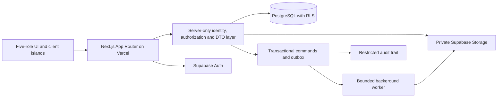

# System architecture — Step 7 proposal

## Step 13 limited connection update

The owner created the school-erp Supabase project and authorized local client configuration, prepared minimal deny-by-default migrations and staff session scaffolding. The modern publishable-key read-only Auth settings probe returned HTTP 200. No SQL/migration was executed, user/session created, staff/PIN login enabled, real school data connected, deployment made or Git operation performed. Region/Free-plan details are owner-reported. Step 12 source/contracts and dashboards remain unchanged; live RLS, staff role/context/MFA/refresh integration and PIN provider proof remain pending. See [Step 13 scope and limits](STEP-13-SUPABASE-FOUNDATION.md) and [report](../../STEP-13-REPORT.md). Older no-connection statements below describe earlier milestones.

## Step 12 current singleton login scope

Initial login eligibility is one Student to at most one active explicitly provisioned Parent, and one Parent login identity to exactly one Student. Both family forms have only registration number and their independent six-digit PIN. Multi-child and multiple login-eligible guardian expansion is deferred; richer non-login domain relationships and fictional Parent UI remain preserved. The earlier Step 11 blocker remains historical for the prior multi-guardian scope. New pure contracts perform no real authentication; five roles and Super Admin authority remain unchanged. See [current identity policy](STEP-12-SIMPLIFIED-PARENT-IDENTITY.md) and [integration gate](STEP-12-NEXT-INTEGRATION-GATE.md). Local foundation complete; isolated provider proof pending; production authentication not approved.

## Step 8 authoritative update

The current local auth library is pure policy only and is not wired into routes. All dashboards remain public mock previews; protected-data deployment is blocked on real verification and RLS. Server-only Super Admin module review must preserve active Admin context, bounded projections and audit.

Approved role/login/provisioning requirements take precedence over conflicting historical Step 7 text below. Proposed mechanisms are not deployed controls. See [access model](SUPER-ADMIN-ACCESS-MODEL.md), [PIN design](STUDENT-PARENT-PIN-AUTH-DESIGN.md), [bootstrap](SUPER-ADMIN-BOOTSTRAP-PLAN.md) and [threat model](AUTHENTICATION-THREAT-MODEL.md).

## Retained Step 7 blueprint (subject to the update above)

Status: **planning only**, 5 November 2026. Nothing in this directory is an implemented security control. Existing source remains the public fictional preview described in reports 1–6. Start with [decisions](ARCHITECTURE-DECISIONS.md), [schema](DATABASE-SCHEMA-BLUEPRINT.md), [permissions](ROLE-PERMISSIONS-MATRIX.md), and [roadmap](IMPLEMENTATION-ROADMAP.md).

## Confirmed codebase audit

| Evidence | Confirmed implementation | Integration consequence |
| --- | --- | --- |
| `package.json`, `tsconfig.json` | Next 16.4.5 / React 19.3.1 / TS 6 strict, Tailwind 4, Motion, Radix, Lucide; webpack scripts | Retain stack; review installed-version docs before future edits. No Supabase SDK or runtime schema validator installed. |
| Root inventory | No `next.config.*` file; no Proxy, API route, auth helper, SQL, or migrations found | Framework defaults plus webpack CLI flags; proposed paths below do not exist yet. |
| `src/app/(dashboard)/*/layout.tsx` | Role is a literal passed to shared DashboardShell | Layout identity is presentation, not authorization. All five routes currently public. |
| `src/config/roles.ts`, `navigation.ts` | Exactly admin/teacher/student/parent/accountant; future modules disabled | Keep exactly five primary roles. Principal/office responsibilities become restricted Admin permission sets. |
| `role-preview-switcher.tsx` | Development-only navigation via router.push | Never reuse it as production role assignment. Production active-role switch must validate membership. |
| Admin page | Server `connection()` plus live India greeting date; underlying analytics fixed mock data | Explicitly separate current clock, academic year, reporting window, and snapshot. |
| Admin/Teacher/Student `index.tsx` | Server composition; client motion/filter islands | Good starting point for authorized server queries and minimal DTO props. |
| Parent `parent-portal.tsx` | Entire two-child mock dataset imported into client; keyed child subtree resets controls | Real children must first be authorized; fetch selected-child DTO server-side. Never hydrate every school's records then filter. |
| Accountant `financial-workspace.tsx` | Entire small ledger in client; one period state; history filtered/paginated locally | Retain UX, move authorization, totals, paging, and search to server/DB. |
| All five data modules | Typed, deterministic, feature-specific records; differing dates/units/scopes | These are fixtures, not production source data. Admin/Parent rupees and Accountant paise must not be joined by arithmetic assumptions. |
| `financial-calculations.ts` | Invoice-cohort balances vs date-filtered cash reconcile only under stated same-month mock convention | Replace with distinct production views in [financial design](FINANCIAL-DATA-DESIGN.md). |
| Shared layout / CSS / Motion | Sidebar collapse, Radix drawer, skip link, focus indicators, reduced-motion branches; original SVG; CSS/SVG charts with text/tables | Preserve these strengths. Prior focused browser QA is not a full accessibility audit. |
| App tree | Loading skeleton exists; no feature `error.tsx`, `global-error.tsx`, or custom `not-found.tsx` found | Add authorized loading/error/empty/forbidden/not-found states in later implementation. Never show zero as an error fallback. |
| Feature helpers | Local formatting/calculation duplication, dense JSX; subject lookup can throw on invalid IDs | Later extract stable shared contracts selectively; validate backend DTOs and handle missing/deleted references. No broad rewrite in this step. |
| `verification/verify-*-data.mjs` | Five in-memory Node assertion suites; no browser automation framework dependency | Useful financial/date regression evidence, not auth/RLS tests. No integration/adversarial suite currently exists. |
| README and reports | Historical moderate dev-tool advisories; production preview route checks previously passed | Historical results, not a fresh audit of dependencies or deployed security. No audit/network install run in Step 7. |

Strengths: isolated feature CSS, central role/navigation definitions, strict types, original local assets, deterministic calculations, accessible textual chart alternatives, no fake payments, and documented limits. Highest risks before real data: absent authentication/RLS, full-dataset client hydration, independent financial fixtures, no persistent publication/guardian/assignment model, no real transactional writes, no operational recovery or security tests. These are expected missing backend capabilities, not evidence of an existing data breach.

## Proposed production topology

One school, one school configuration record, one production database; **no tenant IDs, subscriptions, school switching, or SaaS plans**. Academic year, class, section, enrollment, term, subject, and effective-date relationships provide historical separation, not tenancy. Single-school grade groups remain reporting projections, not authorization domains.

### Boundaries and future file organization

Proposed only: `src/lib/supabase/{browser,server,privileged}.ts`; `src/lib/auth/{identity,context,permissions}.ts`; `src/server/{queries,commands,validation,dto}`; `src/proxy.ts`; domain-specific future Server Actions/Route Handlers. Keep secrets and sensitive domain code marked server-only. Generated DB types supplement runtime validation, not replace it.

Server Components: session-aware entry pages, authorization, initial dashboard aggregates, table pages, document authorization. Client islands: filters, charts using already-authorized aggregates, child selector, forms, accessible interactions. Serialize minimal records; money as decimal paise strings and formatted display values, not unsafe JS bigint JSON or uncontrolled numbers. Parent child switch requests only a linked child's data; accountant receives fee identifiers rather than medical/emergency/personnel data.

Server Actions: same-origin interactive commands with rechecked identity, active role, permission, relationship, input schema and concurrency version. They are externally callable endpoints, not trusted because a form uses them. Route Handlers: auth callbacks, authorized download gateways, external integrations/webhooks, bounded report jobs. Verify Origin/Host, anti-CSRF protections for cookie-authenticated mutations, request method/content type, body size and allowlisted redirects. No mutations through GET. Webhook signatures/idempotency are independent of browser sessions.

Browser Supabase client: publishable key plus user session only for approved narrow RLS reads/auth and carefully scoped realtime; no privileged writes or full financial datasets. Server client: request-scoped user JWT so DB RLS stays active. Privileged secret client: isolated provisioning/maintenance worker only, never normal dashboard queries; app authorization and explicit subject audits are still required. Publishable and secret keys have different trust boundaries; secret/service-role credentials must never ship to the browser. [Supabase key guidance](https://supabase.com/docs/guides/getting-started/api-keys).

### Authorization, sessions and caching

See [authentication](AUTHENTICATION-PLAN.md) and [RLS](RLS-SECURITY-BLUEPRINT.md). Validate identity, live account status, active role context and membership on every protected data operation. Proxy may refresh cookies/perform early redirects; it is not the final security boundary. Installed Next 16 documentation calls Middleware **Proxy** and warns against treating it as full authorization (`node_modules/next/dist/docs/01-app/01-getting-started/16-proxy.md`).

Default private data to request-time uncached reads; no public ISR/CDN cache for identity-bearing HTML, cookie refresh, report responses or child data. Request-local memoization only after identity validation. Any later cache key must include principal, session/role version, relevant record authorization version, year and filters; revocation must invalidate it. Revalidate only authorized paths after commit. Route/session changes clear client DTO/query state; do not preserve another role's results.

### Validation, errors, observability

At each boundary validate UUIDs, dates/timezone, allowed actions, year/section membership, sizes, quantities, decimal paise strings and legal status transitions. Allowlist mutable columns; derive actor/owner from trusted identity. Parameterized queries; no client-supplied SQL/sort identifiers. Database checks/FKs backstop validation and transactional routines enforce cross-row invariants.

Later add domain error boundaries and typed outcomes: unauthenticated, forbidden, not found, invalid input, stale version, conflict, temporary failure. Generic UI errors with request IDs; redacted structured server logs. Do not log tokens, raw message bodies, student documents, government IDs or full payment payloads. Append critical domain audits and outbox events in the same transaction. External job failures retain pending status and retry; never fabricate success.

## Environment and deployment plan — not configured

| Environment | Proposed separation | Gate |
| --- | --- | --- |
| Local | Local Supabase stack and synthetic seed; no production credentials/data | Repeatable schema + RLS tests, no outbound messages |
| Test/staging | Dedicated nonproduction Supabase project; Vercel Preview/staging variables; synthetic or approved deidentified fixtures | E2E/adversarial access tests, restore drill, reviewer sign-off |
| Production | Separate project, region and Vercel protected deployment settings; tightly held secrets | Owner authorization, recovery evidence, policy/legal review, deployment checklist |

Future variable **names only**: public URL and publishable key; server-only Supabase secret, database migration connection and monitoring/upload-scan secrets. No values or `.env` files created. Public prefixes are only for intentionally public configuration. Scope variables to environments, rotate leaked secrets, restrict CI permissions, never route arbitrary preview branches to production. Vercel environment-specific configuration is documented in its [environment guide](https://vercel.com/docs/deployments/environments); verify first-deployment behavior before enabling any integration.

Migrations: future reviewed, versioned, additive-first changes through CI into staging then approved production; no console drift. Seeds explicitly reject production. Separate migration owner from runtime credentials; use pooler appropriate to request/transaction behavior, never rely on a session variable persisting across pooled connections. App rollback does not undo schema/data changes; use expand/contract and tested forward repair.

Recovery proposal: owner-approved RPO/RTO, database backups/PITR as budget allows, encrypted off-site recovery copies, separate object backup, audit recovery, quarterly isolated restore drills and reconciliation. Supabase database backups do not restore stored object bytes; plan file backups independently. [Supabase backups](https://supabase.com/docs/guides/platform/backups). Initial proposed goals: financial RPO ≤15 minutes and RTO ≤4 hours, subject to budget/feasibility approval; they are not guarantees.

Monitor failed authorization spikes, role/guardian changes, denied downloads, reconciliation drift, slow queries, outbox age, backup freshness and restore success. Define school support owner, incident escalation, secret revocation and access suspension runbooks before release.

## Verification boundaries

Step 7 reads source and documents proposals. Five existing pure-data suites were rerun successfully. No app changes, build, dev server, SQL, SDK installation, environment creation, external project/account access, or production requests were performed. Public vendor/legal documentation was read only. New schema/RLS/transactions below are not database-tested.
