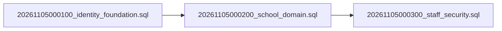

# Step 15 — Database Migration Application Readiness

**Date:** 2026-11-05  
**Assessment:** Option A — Full Local SQL Audit & Security Review  
**Safety Protocol:** STRICT SAFETY BOUNDARY — No SQL Execution, No Remote Connection, No Migrations Applied.

---

## 1. Readiness Gate Decision

### **OPTION A: READY FOR SEPARATELY AUTHORIZED MIGRATION APPLICATION**

All local static checks, foreign key dependency analyses, RLS constraint reviews, and application-to-SQL consistency verifications have passed completely. No local blockers remain in the SQL DDL files.

> [!IMPORTANT]
> **Explicit Boundary Notice:** "Ready for separately authorized migration application" means the local SQL files are sound, verified, and architecturally consistent. It does **NOT** mean migrations have been applied, live RLS has been tested on PostgreSQL, or production deployment is approved.

---

## 2. Prerequisites for Separately Authorized Execution

Before any command is executed against any PostgreSQL database or Supabase instance, the following prerequisites **MUST** be verified:

1. **Clean Target Database:**
   The migrations are transactional and non-idempotent. The target schema must not contain conflicting tables (`roles`, `profiles`, `students`, etc.). An empty development/staging project or isolated local database is required.
2. **Supabase Auth Schema Compatibility:**
   The target database must have Supabase Auth installed with GoTrue tables available:
   - `auth.users` with columns `id`, `email_confirmed_at`, `banned_until`.
   - `auth.sessions` with columns `id`, `user_id`.
   - `auth.mfa_factors` with columns `id`, `user_id`, `status`.
3. **Project URL Verification:**
   Migration `20261105000300_staff_security.sql` pins the native JWT issuer to:
   `https://yedvkcwkflhbqumjwknh.supabase.co/auth/v1`
   If executing against any other instance, this string must be coordinated or configured.
4. **Migration Execution Role:**
   The migrations must be executed by a role with administrative privileges (e.g. `postgres` or `supabase_admin`) so that `alter function ... owner to postgres;` and `revoke create on schema public` succeed.
5. **Separate Owner Authorization:**
   Explicit written confirmation from the school project owner authorizing connection and execution against a designated isolated environment.

---

## 3. Execution Sequence

When authorization is granted, the files must be applied in exact order:

1. **Step 1:** `supabase/migrations/20261105000100_identity_foundation.sql`
   - Creates 5 identity tables (`roles`, `profiles`, `user_roles`, `admin_privileges`, `role_contexts`).
   - Seeds 5 primary roles (`admin`, `teacher`, `student`, `parent`, `accountant`).
   - Enables and forces RLS; revokes ordinary grants.
2. **Step 2:** `supabase/migrations/20261105000200_school_domain.sql`
   - Creates 12 domain tables (`school_configuration`, `staff_profiles`, `academic_years`, `classes`, `sections`, `students`, `guardians`, `student_guardian_relationships`, `parent_login_identities`, `enrollments`, `teacher_assignments`, `audit_events`).
   - Creates domain indexes, partial unique index `parent_login_one_eligible_student`.
   - Enables and forces RLS; revokes ordinary grants (default-deny).
3. **Step 3:** `supabase/migrations/20261105000300_staff_security.sql`
   - Revokes `CREATE` on schema `public`.
   - Adds `permissions` array and check constraint to `user_roles`.
   - Creates `app_private` schema and revokes all grants.
   - Creates 5 security definer and 2 invoker functions.
   - Creates `staff_mfa_enrollment_approvals` table.
   - Creates 4 self-scoped `SELECT` policies for `authenticated`.
   - Creates 5 triggers (audit immutability and context invalidation).

---

## 4. Rollback and Recovery Strategy

Each migration file is enclosed in a single transaction block (`begin; ... commit;`). If any error occurs during execution of a file:
- The active transaction will automatically abort and roll back all changes within that file.
- Downstream migrations will not run.

### Manual Reverse Drop Sequence (Emergency Teardown)
If a deployed migration must be manually uninstalled in reverse order:
1. **Drop Migration 3 Objects:**
   - Drop triggers: `tier_context_invalidation`, `membership_context_invalidation`, `profile_context_invalidation`, `audit_events_no_truncate`, `audit_events_immutable`.
   - Drop policies: `contexts_current_session`, `tier_self_metadata`, `memberships_self_metadata`, `profiles_self_metadata`.
   - Drop functions: `app_private.invalidate_staff_contexts`, `public.revoke_staff_context`, `public.activate_staff_context`, `app_private.reject_audit_change`, `public.consume_staff_mfa_enrollment_approval`, `public.staff_session_is_live`, `public.is_native_staff_request`.
   - Drop table: `public.staff_mfa_enrollment_approvals`.
   - Drop schema: `app_private`.
   - Drop column `permissions` on `public.user_roles`.
2. **Drop Migration 2 Objects:**
   - Drop tables in reverse FK order: `audit_events`, `teacher_assignments`, `enrollments`, `parent_login_identities`, `student_guardian_relationships`, `guardians`, `students`, `sections`, `classes`, `academic_years`, `staff_profiles`, `school_configuration`.
3. **Drop Migration 1 Objects:**
   - Drop tables in reverse FK order: `role_contexts`, `admin_privileges`, `user_roles`, `profiles`, `roles`.

---

## 5. Post-Migration Live Verification Plan

Once applied to an isolated test environment, execute the **20 integration test scenarios** defined in `supabase/tests/step-14-rls-plan.json` (currently marked `NOT RUN`):
- `R01`: Anonymous access denied across all tables.
- `R02–R04`: Student and Parent cross-access and revoked access denied.
- `R05`: Teacher unassigned class access denied.
- `R06–R07`: Accountant and Ordinary Admin unauthorized role/user creation denied.
- `R08`: Super Admin mandatory AAL2 and active Admin membership proven with live JWTs.
- `R09–R10`: Invalidation of contexts on role revocation or account suspension.
- `R11–R12`: Cross-role data access and direct Data API writes denied.
- `R13`: Audit update/delete/truncate attempts fail with exception.
- `R14`: Financial immutability contracts verified.
- `R15`: Stale/expired context rejection.
- `R16`: Storage access fails closed.
- `R17`: Concurrent parent eligibility race condition fails on partial unique index.
- `R18`: Context activation cannot revive revoked session context.
- `R19`: Provider logout/ban terminates `staff_session_is_live()`.
- `R20`: Full native MFA enrollment, verification, and cookie refresh under approved ceremony.

---

## 6. Operational Feature Flags

To ensure complete safety before live RLS verification:
- `STAFF_AUTH_REQUESTS_ENABLED=false` must remain disabled locally and in all configurations until live RLS is verified.
- `LIVE_AUTHENTICATION_ENABLED=false` must remain disabled for Student/Parent PIN logins until six-digit PIN security proof is approved.
- All five public fictional dashboards (`/admin/dashboard`, `/teacher/dashboard`, etc.) remain fully functional and uncoupled from live database state.
