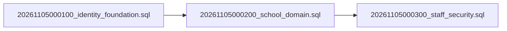

# Step 16A — Database Migration Preflight & Schema Readiness

**Date:** 2026-11-05  
**Assessment:** Step 16A Local Security Hardening, SQL Migration Corrections & Database Preflight  
**Safety Protocol:** STRICT SAFETY BOUNDARY — No SQL Execution, No Remote Connection, No Migrations Applied.

---

## 1. Executive Preflight Verdict

### **VERDICT: A — READY FOR SEPARATELY AUTHORIZED ISOLATED MIGRATION**

All identified schema-blocking, referential integrity, and function security issues have been audited and resolved offline. The three migration files are ready for separately authorized execution against an **isolated development/staging database**.

> [!IMPORTANT]
> **CRITICAL ARCHITECTURAL DISTINCTION:**
> **Schema Migration Readiness is Outcome A**, while **Live Super Admin MFA Lifecycle is BLOCKED (Finding SEC-01)**.
> - The PostgreSQL schema, tables, foreign keys, RLS policies, definer functions, and triggers are hardened and ready for isolated database execution.
> - However, live staff authentication (`STAFF_AUTH_REQUESTS_ENABLED=false`) and Student/Parent PIN login (`LIVE_AUTHENTICATION_ENABLED=false`) **MUST REMAIN DISABLED**.
> - Applying the schema to an isolated database exposes zero data because all 12 school domain tables are 100% default-deny and no real users or credentials exist.

---

## 2. Exact Migration Sequence and SHA-256 Hashes

The three migrations audited in exact order:



| Order | Migration File | SHA-256 Hash | Status |
| :---: | :--- | :--- | :---: |
| 1 | `supabase/migrations/20261105000100_identity_foundation.sql` | `3595e2f46d25c8feba39572ef248bd79b1e042052a7de0fbd3c9e5df79dc1c8c` | **PRESERVED** |
| 2 | `supabase/migrations/20261105000200_school_domain.sql` | `dd26d701fdf61beda3a6cdff60972b20ea201ddb207c29c864652d8420e2327e` | **PRESERVED** |
| 3 | `supabase/migrations/20261105000300_staff_security.sql` | `0664187c5d4a3ed6e3d83b4e7f365ed7e58d010b117565ce3e7d65f468307ce9` | **PRESERVED** |

*All three migrations remain byte-for-byte identical to their Step 15 baselines. No destructive or arbitrary rewriting was performed.*

---

## 3. Database Invariant Enforcement Matrix

Every system invariant identified across Steps 1–16A is categorized by its precise enforcement layer:

| System Invariant | Enforcing Mechanism | Layer | Status |
| :--- | :--- | :--- | :---: |
| Exactly 5 Primary Roles | `check (code in ('admin','teacher','student','parent','accountant'))` on `public.roles` | PostgreSQL Check | **Enforced in SQL** |
| Super Admin is Tier, Not 6th Role | `(profile_id, role_code) references public.user_roles(profile_id, role_code)` on `admin_privileges` | PostgreSQL FK | **Enforced in SQL** |
| $\le 1$ Login-Eligible Parent per Student | `CREATE UNIQUE INDEX parent_login_one_eligible_student ON public.parent_login_identities(student_id) WHERE login_eligible;` | PostgreSQL Partial Index | **Enforced in SQL** |
| Exactly 1 Student per Parent Identity | `profile_id uuid primary key` & `student_id uuid not null` on `parent_login_identities` | PostgreSQL PK / Check | **Enforced in SQL** |
| Canonical Guardian Identity Binding | `(guardian_id, profile_id) references public.guardians(id, profile_id)` | PostgreSQL Composite FK | **Enforced in SQL** |
| Legitimate Relationship Binding | `(relationship_id, student_id, guardian_id) references public.student_guardian_relationships` | PostgreSQL Composite FK | **Enforced in SQL** |
| Mandatory AAL2 on Super Admin Context | `if auth.jwt()->>'aal' is distinct from 'aal2' ... return false;` in `activate_staff_context()` | PL/pgSQL Definer | **Enforced in SQL** |
| Revoked Context Permanence in Session | `ON CONFLICT (id) DO UPDATE ... WHERE revoked_at IS NULL` fails closed if revoked | PL/pgSQL Definer | **Enforced in SQL** |
| Audit Trail Immutability | `BEFORE UPDATE OR DELETE` & `BEFORE TRUNCATE` triggers on `public.audit_events` | PL/pgSQL Triggers | **Enforced in SQL** |
| Function Search Path Hijack Protection | `SET search_path = ''` on all 7 functions | PostgreSQL Function DDL | **Enforced in SQL** |
| Execution Grant Revocation | Explicit `REVOKE ALL ON FUNCTION ... FROM public, anon` | PostgreSQL DDL Grants | **Enforced in SQL** |
| Domain Data Isolation | 100% Default-Deny (zero allowing policies on 12 domain tables) | PostgreSQL RLS | **Enforced in SQL** |
| Verified Relationship Status | Validating `relationship_status === 'verified'` before setting `login_eligible = true` | Application DAL | **Application Logic** |
| Active Parent Profile Status | Validating `profiles.account_status === 'active'` on Parent identity | Application DAL | **Application Logic** |
| Distinct Student/Parent Identities | Rejecting identical profile IDs between Student and Guardian candidates | Application Contracts | **Application Logic** |
| Enrollment & Teaching Date Overlaps | Temporal non-overlap checks across academic sections | Application Transactions | **Application Logic** |
| First Super Admin Onboarding | Initial provisioning ceremony and independent approval creation | Operator Workflow | **Operator Ceremony** |
| Financial Ledger Immutability | Ledger tables, double-entry consistency, and settled transaction immutability | Future Schema | **Future Milestone** |

---

## 4. GoTrue Engine Compatibility Requirements

Before applying migrations to an isolated target, verify that the host database environment satisfies these exact specifications:

1. **Target Schema Dependencies:**
   - `auth.users`: Columns `id (uuid)`, `email_confirmed_at (timestamptz)`, `banned_until (timestamptz)`.
   - `auth.sessions`: Columns `id (uuid)`, `user_id (uuid)`.
   - `auth.mfa_factors`: Columns `id (uuid)`, `user_id (uuid)`, `status (auth.factor_status)`.
2. **JWT Issuer Alignment:**
   - `is_native_staff_request()` verifies: `auth.jwt()->>'iss' = 'https://yedvkcwkflhbqumjwknh.supabase.co/auth/v1'`.
   - If deploying to a different Supabase project reference, this string must be coordinated before execution.
3. **Execution Privileges:**
   - Must be executed by `postgres` or an equivalent role capable of running:
     `ALTER FUNCTION ... OWNER TO postgres;`
     `REVOKE CREATE ON SCHEMA public FROM public, anon, authenticated;`

---

## 5. Rollback and Recovery Protocol

Each migration file is an atomic transaction (`begin; ... commit;`). If any statement encounters an error:
- The entire transaction automatically aborts and rolls back to pre-migration state.
- No partial objects persist.

### Reverse De-provisioning Sequence (Clean Teardown)
If a manually applied test schema needs complete uninstallation, execute drops in strict reverse dependency order:
```sql
-- 1. Teardown Migration 3
drop trigger if exists tier_context_invalidation on public.admin_privileges;
drop trigger if exists membership_context_invalidation on public.user_roles;
drop trigger if exists profile_context_invalidation on public.profiles;
drop trigger if exists audit_events_no_truncate on public.audit_events;
drop trigger if exists audit_events_immutable on public.audit_events;
drop function if exists app_private.invalidate_staff_contexts();
drop function if exists public.revoke_staff_context();
drop function if exists public.activate_staff_context(text);
drop function if exists app_private.reject_audit_change();
drop function if exists public.consume_staff_mfa_enrollment_approval();
drop function if exists public.staff_session_is_live();
drop function if exists public.is_native_staff_request();
drop table if exists public.staff_mfa_enrollment_approvals;
drop schema if exists app_private;
alter table public.user_roles drop column if exists permissions;

-- 2. Teardown Migration 2
drop table if exists public.audit_events cascade;
drop table if exists public.teacher_assignments cascade;
drop table if exists public.enrollments cascade;
drop table if exists public.parent_login_identities cascade;
drop table if exists public.student_guardian_relationships cascade;
drop table if exists public.guardians cascade;
drop table if exists public.students cascade;
drop table if exists public.sections cascade;
drop table if exists public.classes cascade;
drop table if exists public.academic_years cascade;
drop table if exists public.staff_profiles cascade;
drop table if exists public.school_configuration cascade;

-- 3. Teardown Migration 1
drop table if exists public.role_contexts cascade;
drop table if exists public.admin_privileges cascade;
drop table if exists public.user_roles cascade;
drop table if exists public.profiles cascade;
drop table if exists public.roles cascade;
```

---

## 6. Pre-Execution Checklist for Separately Authorized Step

When explicit owner authorization is provided to proceed with isolated execution:

- [ ] Confirm the target database is an **isolated development/staging instance** (never production).
- [ ] Confirm target database has zero existing application tables (`roles`, `profiles`, etc.).
- [ ] Verify target GoTrue version satisfies column dependencies in `auth.users`, `auth.sessions`, and `auth.mfa_factors`.
- [ ] Confirm migration runner role is `postgres`.
- [ ] Apply `20261105000100_identity_foundation.sql`.
- [ ] Apply `20261105000200_school_domain.sql`.
- [ ] Apply `20261105000300_staff_security.sql`.
- [ ] Execute the 20 live integration tests in `supabase/tests/step-14-rls-plan.json` using synthetic accounts.
- [ ] Keep `STAFF_AUTH_REQUESTS_ENABLED=false` and `LIVE_AUTHENTICATION_ENABLED=false` until all 20 live scenarios pass.
